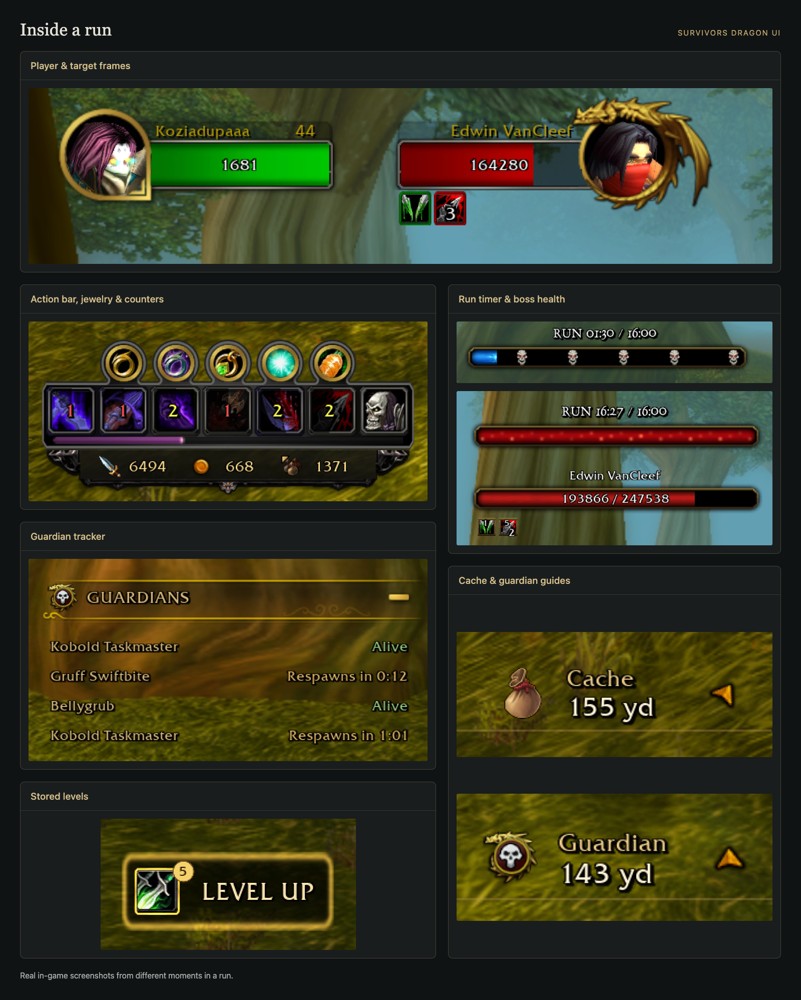

<p align="center">
  
</p>

# SurvivorsDragonUi

[](https://github.com/migwynkriid13/SurvivorsDragonUi/releases/latest)
[](https://github.com/migwynkriid13/SurvivorsDragonUi/releases/latest)
[](https://github.com/migwynkriid13/SurvivorsDragonUi/releases)
[](docs/LOCALIZATION.md)

A Dragonflight-style UI addon for **Azeroth Survivors**. It brings your action bar, run timer, boss health, guardian tracker and guides into a HUD you can move, resize and hide to suit your setup.

[**Download the addon**](https://github.com/migwynkriid13/SurvivorsDragonUi/releases/latest/download/SurvivorsDragonUi.zip) · [Report a problem](https://github.com/migwynkriid13/SurvivorsDragonUi/issues)

## In game

[](docs/screenshots/overview.png)

Real screenshots from different moments in a run, arranged into one overview. [Open the full image](docs/screenshots/overview.png) or browse the [original screenshots](docs/screenshots/originals/).

## What you get

- **Your combat HUD:** player and target frames, a restyled character window, seven action buttons, equipped jewelry, buff timers, XP, kills, gold and cache cost.
- **Run and boss tracking:** a run timer with boss markers, boss health bars, event banners and revive progress.
- **Guardian tracking:** living guardians, respawn timers and health bars during fights. Use the tracker's plus/minus button to switch between living guardians and all lairs.
- **Cache and guardian guides:** distance, direction arrows and minimap markers to help you find them. Enable **Guide to next respawn** under **Map & navigation** to follow the next guardian respawn when all are defeated. Hover a guardian marker to see its name beside the cursor.
- **Level Up and summons:** a button for your stored levels, plus names, icons and durations for up to eight active summons. Extra summons appear as a count.
- **Combat text, meters and loot:** damage numbers with Over enemies, MSBT-style scrolling or Diablo IV styles, a DPS meter with The War Within artwork and retail-style loot popups. Choose the text style in `/sdui` → **Combat** → **Combat text**. With Custom and MSBT-style scrolling selected, move the stream's outline in `/sdui` or `/sdui lock`, then Confirm. **Nameplates** offers font sizing, **Names only** and a bosses-and-guardians filter; keep V on to see names without bars. Choose SDUI, Game or Off under **Interface** → **Loot notifications**, with an option to show marks rewards from collected items. Duplicates without rewards stay hidden.
- **Chat:** a transparent window, shorter game messages and mouse-wheel history.
- **Layout editor:** move, resize or hide HUD groups, adjust tooltips and save named profiles. Supports all 14 game languages, including Czech.

## Install

1. Download [SurvivorsDragonUi.zip](https://github.com/migwynkriid13/SurvivorsDragonUi/releases/latest/download/SurvivorsDragonUi.zip) from the latest release.
2. In the game, open **Options → AddOns → Open AddOns Folder**.
3. Extract the ZIP and put the `SurvivorsDragonUi` folder there.
4. Enable the addon and enter a run. Type `/sdui` to set it up.

For a manual Windows install, open the folder containing `AzerothSurvivors.exe` and place the addon in `benilla-config/AddOns/`. The finished path should be:

```text
benilla-config/AddOns/SurvivorsDragonUi/SurvivorsDragonUi.toc
```

**Optional Windows auto-update:** Download [avrt.dll](https://github.com/migwynkriid13/SurvivorsDragonUi/releases/latest/download/avrt.dll) and place it beside `AzerothSurvivors.exe`. It updates the addon before the game starts. If checking or downloading fails or takes more than 10 seconds, the game starts with your installed copy. Enable the addon in **Options → AddOns**.

Remove `avrt.dll` to stop automatic updates. It cannot be used alongside another mod that needs the same filename. See [details and troubleshooting](updater/README.md).

**Playing in a browser?** Open **Options → AddOns → install a .zip** and choose the downloaded ZIP.

<details>
<summary>Windows settings and older installations</summary>

The game keeps addons, addon data, options, key bindings, chat windows and camera settings in `benilla-config` beside `AzerothSurvivors.exe`. On the first launch after this folder change, it copies addons and settings from older folders, keeping newer changes and filling in missing settings. Characters are unaffected.

</details>

## Commands

| Command       | What it does                                                                                                                |
| ------------- | --------------------------------------------------------------------------------------------------------------------------- |
| `/sdui`       | Opens the full UI editor.                                                                                                   |
| `/sdui lock`  | Opens the compact movement editor with grid, snapping and frame controls.                                                   |
| `/sdui reset` | Immediately restores the default layout, display options and timer styling. Keeps saved profiles and your combat-text mode. |
| `/copy`       | Opens copyable diagnostics after logging is enabled with `/copy enable`.                                                    |
| `/fstack`     | Toggles an inspector for the UI under your mouse.                                                                           |

Chat logging starts disabled on new installations and updates from older versions. Use `/copy enable` to start logging and `/copy disable` to stop it and clear captured text. Your enable/disable choice is saved; captured messages are never saved.

For UI debugging, `/fstack on` and `/fstack off` set the inspector state, `/fstack next` and `/fstack prev` step through frames, and `/fstack focus` returns to the frame under your mouse.

## Make it yours

Open `/sdui` or click the gold Dragonflight glyph beside the minimap, then drag a frame to move it or drag a corner to resize it. **Party frames** moves the party together, with an outline available even when playing solo. Hold **Shift** while dragging to line it up with other frames or the grid. Gold guides show the alignment. **Show grid** in **Layout** starts on and can hide the grid. Supported HUD groups and the player, target and party health bars have side handles for width. Portraits keep their size. Top/bottom handles change list rows or Chat height. Corners retain their existing resize behavior. For exact positions, sizes or **Hide frame**, use **Layout**. Its **Font** choice changes addon text; the run timer and combat text keep their own font choices.

Settings are grouped into nine categories, with related options together.

For a clear view while moving, use `/sdui lock`. Click a blue frame for its controls, drag to move, or nudge with arrow keys (Shift moves ten units). Choose **Show grid**, **Grid spacing** and **Snap to elements** in the small manager. **Save and close** keeps the changes.

Click **Confirm** in the full editor to save or **Cancel** to undo. Click the minimap glyph again or press **Escape** to cancel and close. Leaving the run or reloading also discards unsaved changes. **Addon defaults** resets the same options as `/sdui reset`.

**Performance Mode**, above **Layout**, starts off. Turn it on for static portraits and HUD effects, chat and banners without fading, and no cooldown numbers. Combat text keeps its usual motion and selected style. Your individual choices return when you turn it off.

### Action bar and portraits

Action buttons start locked. Under **Action bar**, turn off **Lock action buttons** and confirm. You can then Shift-click two occupied buttons to swap their spells. **Show gryphons** adds ornaments at each end of the bar; it starts off. Turn off **Attach XP to action bar** to move the XP bar separately. **Show XP text** adds current XP, required XP and percentage to the bar; it starts off.

Portraits use 2D images by default. Under **Unit frames**, choose **Experimental 3D portraits** or **Hide portraits** for bars without portraits.

**Show health** and **Show health percentage** choose the text on unit health bars. A single value is centered. Enable both for health on the left and percentage on the right, or disable both to hide the text. **Shorten health numbers** starts on; turn it off for full numbers without K/M/B/T. **Encounters** → **Boss bars** and **Guardian tracker** each have their own shortening and percentage switches; percentages start off. **Class-colored health** uses each character's class color for player and party health bars.

### Profiles and tooltips

Use **Profiles** to save a named setup, load it later, overwrite it or delete it. Confirm to keep profile changes; Cancel undoes them. Resetting the addon keeps saved profiles.

Move the **Tooltip** handle to place regular hover cards. Its Layout controls also change tooltip size and visibility. **Tooltip at cursor** makes regular hover cards follow your mouse; it starts off. Skill, equipment, counter and boss-marker tooltips stay above their icons, while aura tooltips appear below theirs.

### Combat text and run display

Under **Combat** → **Combat text**, choose custom damage numbers, turn them off, or use **Game settings**. For the game's damage numbers, choose **Game settings**, then enable **Show Target Damage** in the game options. All settings below the mode selector are dimmed and inactive unless **Custom** is selected; their values are kept. Choose **Default** or **Diablo IV (PT Serif)** under **Font** for any custom damage style. Enable **Abbreviate damage (K, M, B, T)** for shorter values. Diablo IV uses pale white for normal hits, yellow for criticals and amber for unusually large criticals; class colors return when you choose another style. Its numbers keep their launch point while they animate, so crowded nameplates cannot drag them around.

The DPS meter is off by default. Turn on **Enable damage meter** under **Damage meter** and Confirm to show the game's damage totals and DPS. Click its heading to cycle through Damage Done, Healing Done, Boss Damage and Party Damage; scroll for more rows. Party Damage shows heroes with their native portraits during co-op. Choose 1 to 10 rows and which numbers, icons, ranks and header values to show. Move, scale or hide **DPS meter** under **Layout**. Details does not need to be installed.

Use **Encounters** → **Run timer** to change its text and font. In **Boss bars** in the same category, **Guardians in boss bar** adds fighting guardians to the boss bars; it starts off. You can also mirror either guide to put its arrow on the other side. Under **Map & navigation** → **Minimap**, **Keep defeated guardian icons** keeps lair icons visible while guardians are down; it starts off.

## Help

[Open an issue](https://github.com/migwynkriid13/SurvivorsDragonUi/issues) with your game version, addon version and a screenshot or error message. Use `/copy enable` before reproducing a problem, then `/copy` to include diagnostic text. It opens a small page with recent messages; use `<` and `>` to browse the rest. Banner status appears at the top.

Some features need a recent game build. Buff timers and replacement revive bars need game **0.115.0 or newer**. See the [compatibility notes](docs/CLIENT-COMPATIBILITY.md) for known client limits and changes that still need in-game testing, or browse the [technical docs](docs/).

## License and credits

Original addon code and custom artwork by **guzruul**, with Azeroth Survivors adaptations maintained here. Code and custom textures have different permissions; see [LICENSE](LICENSE). Blizzard artwork and other reused material are credited in [third_party/](third_party/).
