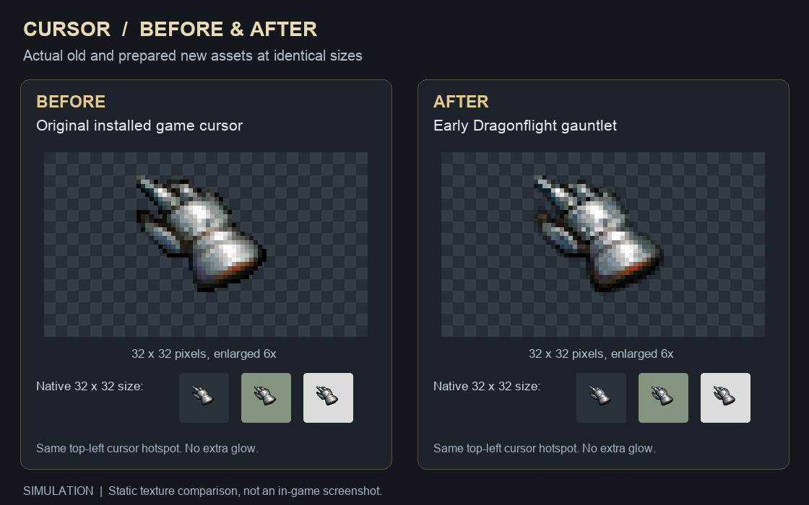

# Native cursor replacement

The addon uses the early Dragonflight gauntlet selected by the user. The user
explicitly chose one hand for normal, attack, loot and spell-targeting modes,
accepting the loss of those contextual cursor pictures. There is no new setting,
SavedVariable, layout group or gameplay collection.

## Native ownership and lifecycle

`modules/ui/cursor.lua` feature-detects the native `SetCursor` and `ResetCursor`
functions. Its argument/return relay uses Lua 5.0's implicit `arg` table and
`unpack(arg)`, retaining native argument checks, errors and return arity. Native
calls run first; the selected hand is then reasserted through the captured setter.
The application guard prevents reentrant hooks from applying recursively.

The client does not expose the current world cursor to addon Lua. A single
`SetCursor` call also cannot replace the normal hand permanently: the world
classifier writes the displayed mode every frame. The existing UI monitor in
`modules/ui/ui.lua` therefore reasserts the selected native cursor before its
separate health-warning throttle. This is the user's chosen all-mode replacement,
not an attempted reconstruction of the game's interaction classifier.

World leave and logout suspend application and reset the native cursor. World
entry allows application again. A missing image retries at most once per second;
a raised binding error releases the cursor and reaches `geterrorhandler()`, with
world entry permitting a later attempt. No native HUD preference is changed.
Reload destroys the Lua hooks with their VM; the native loading cover restores
the default cursor before the next addon initialization.

Native mouse-look hiding remains authoritative, and application skips while
`IsMouselooking()` is true. Held-item/spell/action payload pictures still take
precedence in the native cursor renderer. No mouse-following overlay, UI texture,
mouse input capture or pointer-position polling is added.

## Source evidence and drawing cost

The examined client source is WeNilla commit
[`d68dcc539460e8fc5169105c790443489d91ca76`](https://github.com/Arnesen/wenilla/tree/d68dcc539460e8fc5169105c790443489d91ca76):

- [`container.rs`](https://github.com/Arnesen/wenilla/blob/d68dcc539460e8fc5169105c790443489d91ca76/crates/benilla-ui/src/script/container.rs) implements `SetCursor`, custom-image size checks and `ResetCursor`.
- [`cursor.rs`](https://github.com/Arnesen/wenilla/blob/d68dcc539460e8fc5169105c790443489d91ca76/crates/benilla-app/src/cursor.rs) applies script writes before the world fallback, requires a 32-by-32 custom image, prioritizes held payloads, and caches decoded custom cursors by path. Its unchanged-key guard skips another window-cursor assignment.
- [`lua50.rs`](https://github.com/Arnesen/wenilla/blob/d68dcc539460e8fc5169105c790443489d91ca76/crates/benilla-ui/src/script/lua50.rs) documents the client's `arg`-table varargs. Native `unpack` reads the table's remembered `n`, preserving trailing nil values.

The installed executable contains the matching Lua binding names, the setter's
usage text and the custom-cursor renderer's failure message. This is static
evidence of the integration mechanism, not proof that this public commit is the
packaged game's exact source revision.

The change adds one event-only frame with zero visible regions and zero new
OnUpdate handlers. The existing UI monitor gains one function call per frame.
While active and outside mouse-look, application performs one native
`IsMouselooking` read and one protected native setter call per frame. The client's
same-path custom-mode branch avoids another texture probe in the normal case;
native setters/resetters can require a fresh probe before reapplication. Failed
loads additionally read `GetTime` for the shared one-second retry boundary.

The native renderer lazily creates one cached 32-by-32 cursor image, with no
addon UI regions, UV clamps, material passes or alpha-overlaid cursor frames.
Vararg tables are allocated when another script calls the wrapped cursor APIs,
not by the addon's per-frame reassertion. There are no new recurring gameplay
reads or diagnostics. These source-level costs are not FPS or GPU measurements.

## Artwork preparation and verification

See [Cursor-ARTWORK.md](../third_party/Cursor-ARTWORK.md) for the immutable source,
selected region, ownership and hashes. Preparation is:

```sh
python3 scripts/prepare_cursor_art.py
python3 scripts/prepare_client_textures.py --receipt /tmp/sdui-cursor-textures.json
```

Only `media/tex/cursor/Point.blp` ships. The full source atlas, full-resolution
selected hand and adapted TGA remain preparation inputs outside the manifest.
The 128-to-32 resize is intentional client-size adaptation; the following BLP2
container conversion is lossless.

Data-only comparisons confirmed the full atlas PNG/TGA pixels, the selected
128-by-128 hand and every adapted TGA/BLP BGRA byte, including RGB under zero
alpha. The runtime BLP uses Raw3, eight-bit alpha, one mip and 463 exact RGB
colors. An exact 256-entry palette cannot hold those colors, so no quantization
is used. Local conversion receipts remain with the research artifacts.

The before/after simulation uses the old `Interface\Cursor\Point.blp` extracted
from the installed patch chain and the final prepared new BLP. Both are decoded
with the shared Raw1/Raw3 palette-and-alpha reader and shown at the same size.
It is an asset comparison, not an in-game screenshot.



Verification is source/diff review, asset preparation and pixel comparisons,
plus pinned StyLua/Prettier formatting. No local tests, standalone syntax or
validation checks, addon execution, game startup or live cursor testing were
performed. Runtime appearance, pointer input and cursor transitions remain
unverified. GitHub Actions are not waited on or polled.
