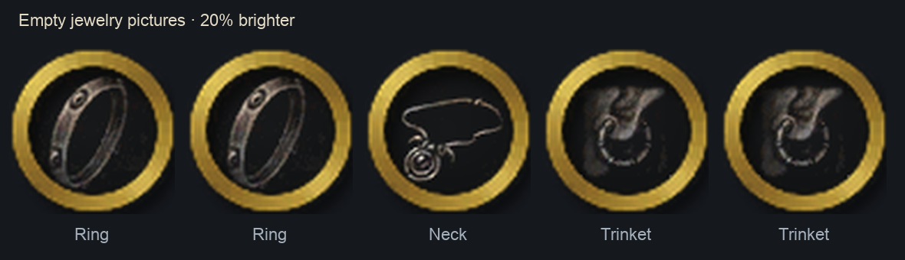

# Equipped jewelry artwork

Selected **03 — Cold-lit runes** uses static Runecarver metal and rune accents, desaturated to grey to match the action-bar surround, with no separate inner-circle rim. The thin-bezel attachment keeps each item joined to the existing action bar without an extra inner/lower curved rail line. Empty slots retain the selected original WoW inventory pictures inside the carving, without a gold circle. The socket body keeps the original bar material, without a panel, title or side ornament. Native item icons are read at runtime rather than bundled into this artwork.

## Selected grey-metal Runecarver housing

- Original Blizzard texture: [`Runecarving/RuneCarvingUI.PNG`](https://github.com/Gethe/wow-ui-textures/blob/da4d3587e46ee7db8655b978d49b7d55024084ff/Runecarving/RuneCarvingUI.PNG), **1024 × 2048**, Gethe mirror commit `da4d3587e46ee7db8655b978d49b7d55024084ff`, **Shadowlands 9.0.5 build 37705**.
- Source SHA-256: `8df6e6c889eda1e100b9550762b573a647730b0435a6702ae194b55b830f124c`.
- `runecarving-frame-runes-lit`: sheet rectangle `(451,1135)-(899,1589)`, **448 × 454**.
- `runecarving-frame-glow`: sheet rectangle `(1,1135)-(449,1589)`, **448 × 454**.
- Atlas names/UVs come from [TextureAtlasViewer Data.lua](https://github.com/LanceDH/TextureAtlasViewer/blob/e58691c23218b25a368f20c8cfebd8f482ed8ce3/Data.lua), embedded **build 37864**. The selected crops were inspected against the earlier pinned 37705 sheet; the complete atlas is not an isolated widget.
- The [native Runeforge crafting XML](https://github.com/Gethe/wow-ui-source/blob/6b65c2922baca3db5a28fb39b69c95cef1047bec/Interface/AddOns/Blizzard_RuneforgeUI/Blizzard_RuneforgeCraftingFrame.xml) separates the normal and runes-lit backgrounds. Its **10.2.7 build 55461** source pin corroborates native use, rather than matching the earlier texture export's build. This jewelry assembly uses the lit artwork continuously, without importing crafting logic or animation.

`scripts/prepare_jewelry_runecarver.py --source /path/to/RuneCarvingUI.PNG` accepts only the pinned source bytes. It clears the original inner crafting controls with an antialiased normalized-radius 0.33 cut, resizes the remaining lit frame to 118 × 120 and places it at `(5,4)` on a transparent 128 × 128 canvas. The original halo resizes to 124 × 126 at `(2,1)`, with source alpha multiplied by 0.32, below the frame. The completed cell blends 95% grayscale with 5% source RGB, retaining the original shading and alpha. This original empty-slot housing remains the unchanged `media/tex/jewelry/Runecarver.tga` authoring input. CI pins its original SHA-256 and exact runtime pixels.

Empty slots and unavailable or unsupported rarities use the original grey
housing. Poor and common items share silver `C8C8C8`. Native ranks 2–5 use
green `57E734`, blue `278DF4`, purple `B44DF2` and orange `FF891E` in order.
Effects-only hover text uses native RGB.

`--runtime media/tex/jewelry/Frame.blp` writes the original neutral cell
`(256,0)-(384,128)` and the silver cell `(384,0)-(512,128)`. It preserves
the atlas header, stock gold and shared pet/meter artwork.

For a full rebuild, `prepare_jewelry_art.py` places the neutral and silver
cells at `(896,0)` and `(896,128)` in its authoring canvas. The client-texture
repacker copies them to x=256 and x=384 in the **512 × 128** `Frame.blp`.

Build the four-color atlas from the retained neutral input with
`python3 scripts/prepare_jewelry_runecarver.py --rarity media/tex/jewelry/GemmedRunecarver.blp`.
Each 128-square cell composites a rarity halo behind the original housing and
four faceted stones above it. The generator traces the metal silhouette from the
retained housing's alpha, following its spikes and socket bezels. The halo fades
over eight pixels from that outline, tapers to clear at the crop edges and leaves
the item opening clear. Its color blends 7% toward white. The crown sits at
`(64,17.5)`, and the smaller stones sit at `(21,64)`, `(95,34)` and `(95,94)`.
The colored faces fill more of the original grey bezels in all five palettes.

For attached jewelry, generate `AttachedRunecarver.blp` with
`python3 scripts/prepare_jewelry_runecarver.py --attached media/tex/jewelry/AttachedRunecarver.blp`.
The 512 × 256 atlas packs silver through purple across its top row and orange
in the first cell of the bottom row. It samples the three shipped rail strips
at the five socket centers to fade just the rarity halo where it meets the
lower connector or the straight bar. The metal and gems are composited above
that halo. Detached jewelry uses the full contour in the original atlases.
The neutral housing uses the same crop in either position.

Each static `BORDER` region is centered on its icon at local size
`43 * 128 / 108`. The visible reader caches the successful texture and crop.

The Layout edit envelopes include the static canvas. Attached top clearance is 41⅓ units at the reference button size, while the detached region uses the larger of the socket and carving sizes around the same center. The five regions reuse the current overlay, parent visibility and attachment/world cleanup in both Performance Mode states. The existing regions draw the baked halo as part of the housing.

This is original World of Warcraft artwork, copyright Blizzard Entertainment. Public availability and software licenses do not transfer its ownership or supply a blanket art redistribution license. Existing project permission for upstream custom art does not relicense this Blizzard texture; its provenance remains in the shipped jewelry module. No source addon code, fonts or framework is imported.

## Shared pet/meter rim source

- [Karl-HeinzSchneider/WoW-DragonflightUI, commit b8b35451d4621a8097e887385f72ec03e17765f1](https://github.com/Karl-HeinzSchneider/WoW-DragonflightUI/tree/b8b35451d4621a8097e887385f72ec03e17765f1).
- Original file: [`Textures/bagborder2.blp`](https://github.com/Karl-HeinzSchneider/WoW-DragonflightUI/blob/b8b35451d4621a8097e887385f72ec03e17765f1/Textures/bagborder2.blp), 64-by-64 RGBA, preserving source colors and alpha.
- [MIT notice](https://github.com/Karl-HeinzSchneider/WoW-DragonflightUI/blob/b8b35451d4621a8097e887385f72ec03e17765f1/LICENSE), copyright 2022 Karl-HeinzSchneider. The relevant notice is retained in shipped `modules/ui/jewelry.lua` comments.

Original World of Warcraft artwork remains copyright Blizzard Entertainment. The source addon's software license does not transfer ownership of Blizzard artwork. The project owner has confirmed upstream custom texture redistribution permission; this does not change Blizzard ownership. No upstream Lua or fonts are imported. The former panel filigree and timer trim remain absent.

## Preparation and transparency

`scripts/prepare_jewelry_art.py` reads `bagborder2.blp` from a scratch directory supplied with `--sources`. A shared Raw1/Raw3 decoder preserves indexed colors and the separate alpha block; Pillow handles the other source formats. Pillow's own Raw1 path is not used because it omits that alpha block. This tool prepares image assets without loading or executing addon code.

`prepare_jewelry_art.py` retains its 1024-by-256 authoring canvas. The runtime `media/tex/jewelry/Frame.blp` is **512 × 128**, with the stock gold rim at `(1,1)-(73,73)`, shared pet/meter rim at `(129,1)-(201,73)` and the neutral Runecarver cell described above. The client repacker copies the authoring crops without resampling. See [Client compatibility](../docs/CLIENT-COMPATIBILITY.md). The housings are centered on their item and socket positions. The jewelry frame scale is the native action-button width divided by 43.

Native item hover frames remain 32 by 32 at local vertical center 46.5.
The rendered item uses a centered artwork box set by `ICON_ART_SIZE` (currently 33.897596 units), shared by empty-slot
pictures. At reference 36-unit buttons this is
about 28.38 UI units, fitting inside the unchanged Runecarver opening. The
sixteen source bands keep the original fourteen interior UV windows, while
midpoint widths restore nonzero top and bottom caps. Uniform inset scaling
preserves image proportions; source UVs retain `1 / 1.05` magnification, from
`1 / 42` through `41 / 42`, including the complete selected vertical range.
Parts carry their scaled height of `ICON_ART_SIZE / 16` local units. A full five-item row uses
80 pooled image regions instead of 70, through the existing grouped compositor
and hidden/world retirement. No icon getter, clock, worker, frame, extra border
or saved value is added. This fit correction supersedes the earlier exact
fourteen-band geometry requirement; native rendering remains unverified.

Pet frames use the runtime 72-by-72 crop `(129,1)-(201,73)`, from
authoring rectangle `(576,56)-(648,128)`. `prepare_pet_rim` copies the original first rim's
RGB pixels and multiplies its alpha by an antialiased annular mask centered at
`(36, 36)`, retaining the gold band while removing the baked inner and outer
shadow. The circle has transparent padding inside its crop, avoiding a cut
through the shadow at the right edge. The original jewelry and pet/meter
runtime cells remain unchanged; no new runtime file is added.

The damage meter reuses that same prepared pet-rim crop for its circular source
icons: a 31-unit gold rim surrounds a 26-unit native circular icon at the existing
row icon center. It retains the original gold RGB/alpha, without a quality tint
or another prepared image. Legacy fallback strips clip only the source icon;
the complete ring is never sliced. Jewelry uses its own inset sixteen-band icon fit; this does not alter the meter rim. See
[DAMAGE-METER.md](../docs/DAMAGE-METER.md).

## Thin socket attachment

`scripts/prepare_jewelry_sockets.py` reads the existing
`media/tex/actionbars/HDActionBar.tga` as texture data, without importing or
executing addon code. The original artwork and attribution remain intact. At
the 36-unit button reference, it copies the original 12-unit straight upper
edge into the existing 300-by-38 rail space, 26 units below its top. Pixels
above that strip stay clear. A narrow cubic connector starts at `(6.5, 26)`
inside the housing's opaque lower rim and mirrors on the right. Its control
points keep the upper end beneath the housing and bring the lower end flat
into the original 33.5-unit bar join. A 64-segment distance sample reuses the
native bevel phase along the curve. This replaces the exposed horizontal
y=28 crop and its upright tabs, retaining the small bottom arch without the
old upper/side circle. Five existing 13.7-unit-radius cutouts keep the bar and
connector from crossing the item openings. All geometry is baked offline;
runtime region count, UVs and update work are unchanged.

The helper writes `SocketRail.blp`, `SocketRail_2.blp` and `SocketRail_3.blp`
directly through the shared lossless BLP encoder, without a temporary large
atlas. Each 512-by-256 strip retains its 400-pixel content span, one-pixel
neighbour gutters and clear padding. Runtime UVs remain `1/512, 401/512, 0,
152/256`; the existing bar-owned strip group retains its size and anchors.
The lower background and all seven buttons are unchanged. Hiding or detaching
jewelry restores the complete original action-bar artwork.

The prepared jewelry BLP files ship through the runtime manifest. TGA preparation inputs, original source BLPs, sample item icons and previews are excluded. Static image preparation does not establish packaged-client rendering; runtime appearance remains unverified.

## Retired detached silver outline

The old `SocketDetached.tga` / `SocketDetached.blp` drew a second silver circle
behind every detached Runecarver housing. Both files and their runtime-manifest
entry are removed. Jewelry no longer creates those five backing regions or
shows/hides them when attachment changes. Runecarver, item icons, empty-slot
pictures, hover frames and the original detached placement remain.

## Original WoW empty-slot pictures

The user selected proposal **01 — Original WoW**, with the full pictures visible inside the circular jewelry openings. The necklace, ring and trinket reuse Blizzard’s painted inventory placeholders rather than the former generated geometric silhouettes.

- Source mirror: [Gethe/wow-ui-textures, commit e80e3278cc833c89e1f3fc79557b68315d750935](https://github.com/Gethe/wow-ui-textures/tree/e80e3278cc833c89e1f3fc79557b68315d750935), early Dragonflight **10.0.0 build 45454**. These are inherited WoW inventory pictures, not artwork exclusive to that expansion.
- Each original is a 64-by-64 RGBA PNG: [PaperDoll/UI-PaperDoll-Slot-Finger.PNG](https://github.com/Gethe/wow-ui-textures/blob/e80e3278cc833c89e1f3fc79557b68315d750935/PaperDoll/UI-PaperDoll-Slot-Finger.PNG), [UI-PaperDoll-Slot-Neck.PNG](https://github.com/Gethe/wow-ui-textures/blob/e80e3278cc833c89e1f3fc79557b68315d750935/PaperDoll/UI-PaperDoll-Slot-Neck.PNG) and [UI-PaperDoll-Slot-Trinket.PNG](https://github.com/Gethe/wow-ui-textures/blob/e80e3278cc833c89e1f3fc79557b68315d750935/PaperDoll/UI-PaperDoll-Slot-Trinket.PNG).
- Original downloaded bytes are retained under `third_party/sources/jewelry/`, outside the runtime manifest. Blizzard owns the artwork; the mirror does not supply a separate blanket redistribution license. The existing software-license notice above does not relicense these pictures. The shipped jewelry module records the artwork pin and Blizzard ownership.

`scripts/prepare_jewelry_placeholders.py` removes only the four-pixel square frame margin, using source rectangle `(4, 4, 60, 60)`. It scales the entire 56-by-56 interior proportionally on the existing 64-by-64 placeholder canvas: rings use 54 by 54 centered at `(5, 5)`, the necklace uses 50 by 50 at `(7, 7)`, and trinkets use 40 by 40 at `(12, 12)`. Rings and the necklace nearly reach the inner gold edge while their painted shapes retain clearance; trinkets grow only slightly from the earlier 36-pixel fit. The source interior is not zoom-cropped. The original circular background alpha is retained after compositing, keeping the enlarged square ground from creating opaque outer corners. The source paint is brightened by 1.55 to match the chosen preview, without a new tint. Its dark ground is lifted to the charcoal circle where needed so no extra square frame is visible. Outer corners remain transparent.

The painted pictures receive an additional 20% brightness increase after their original preparation and resizing. A mask selects only pixels where the resized source paint already contributes above the charcoal ground; the increase cannot expose or brighten previously hidden square background pixels. Circular background pixels and alpha, gold rims and socket artwork retain their previous values.

The script writes the existing uncompressed RGBA `EmptyNeck.tga`, `EmptyRing.tga` and `EmptyTrinket.tga` preparation inputs. Run `scripts/prepare_client_textures.py` afterwards to produce their existing **BLP2 Raw3** runtime files with the required palette block. Conversion preserves all prepared pixels; TGA inputs, original PNGs, the generator and optional contact sheet stay outside the runtime manifest. No new runtime filename is needed.

The full 64-by-64 image maps to the existing 32-by-32 placeholder frame, independently of the equipped item’s 5% zoom and cropped strips. Both rings share the ring picture and both trinkets share the trinket picture. Attached and detached rows retain their original rims, dimensions and placement; no native reads, tooltip state, layout lifecycle, setting or saved value changes. Only static artwork preparation and previews were performed; game-side rendering remains unverified.

The following historical static preview shows the original placeholder preparation with the former gold rim. That extra rim is no longer drawn by jewelry; the current Runecarver-only preview is above. It is artwork evidence, not an in-game capture. The preview is outside the runtime manifest.

